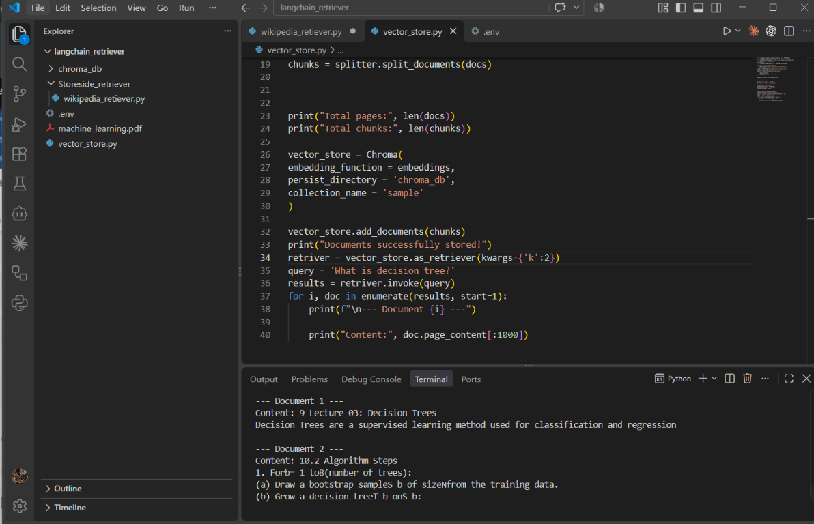

# LangChain Retriever

This project builds a local vector search system using LangChain, Hugging Face embeddings, and ChromaDB. It loads a PDF file, splits the content into manageable chunks, stores the embeddings in a local vector database, and then retrieves the most relevant passages for a user query.

## Project preview



## What this project does

- Loads a PDF using `PyPDFLoader`
- Splits documents with `RecursiveCharacterTextSplitter`
- Creates embeddings using `sentence-transformers/all-MiniLM-L6-v2`
- Stores vectors in a local Chroma collection named `sample`
- Retrieves the top matching document chunks for a search query

## Project structure

```text
langchain_retriever/
├── machine_learning.pdf
├── vector_store.py
├── chroma_db/
├── README.md
├── project-preview.png
└── .env
```

## Requirements

Install the required packages:

```bash
pip install langchain langchain-community langchain-chroma langchain-text-splitters langchain-huggingface python-dotenv pypdf
```

## Run the project

1. Make sure the PDF file exists in the project folder.
2. Run the script:

```bash
python vector_store.py
```

3. The script will:
   - read the PDF
   - split the text into chunks
   - store embeddings in `chroma_db`
   - run a sample query like: `What is decision tree?`

## Example output

```text
Total pages: 9
Total chunks: 18
Documents successfully stored!

--- Document 1 ---
Content: Decision Trees are a supervised learning method used for classification and regression
--- Document 2 ---
Content: 10. Algorithm Steps
```

## Notes

- The vector database is persisted locally in the `chroma_db` folder.
- This project is useful for building a simple RAG-style search workflow on local documents.
- You can change the PDF file and query text in `vector_store.py` to test with other documents.
